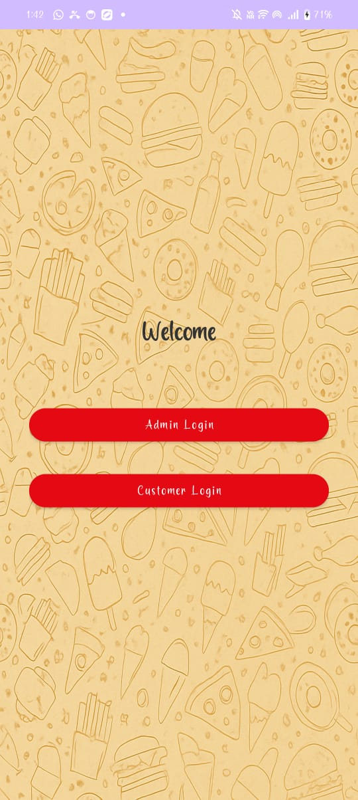
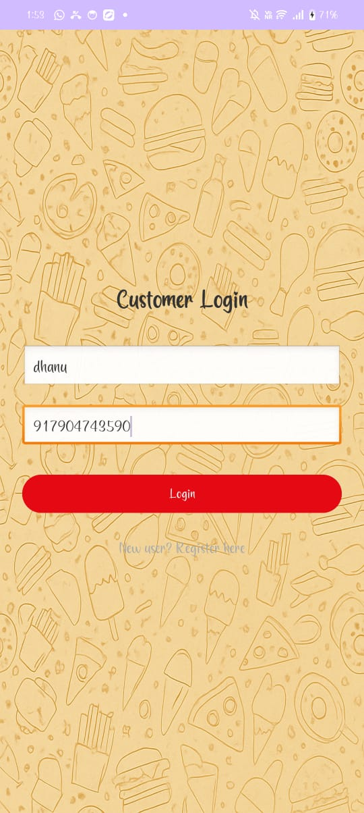
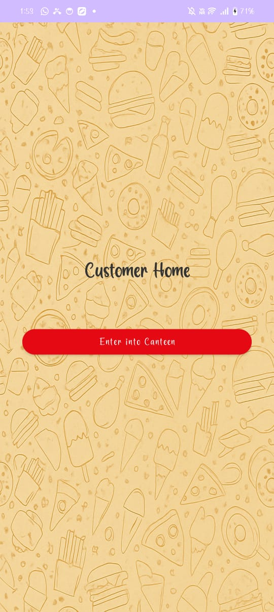
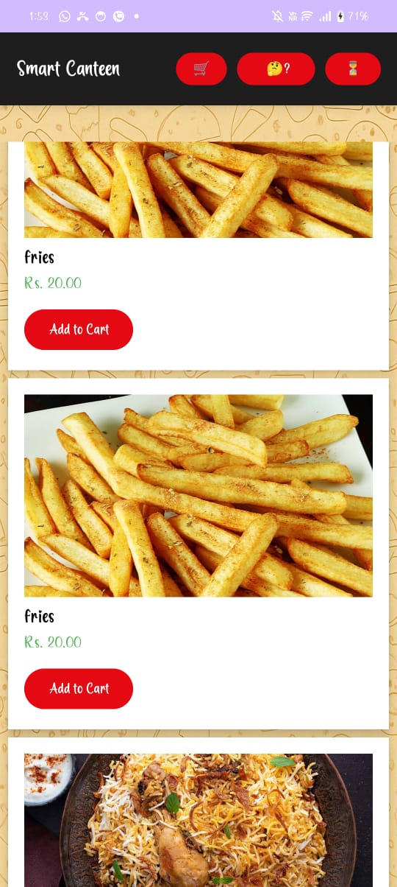
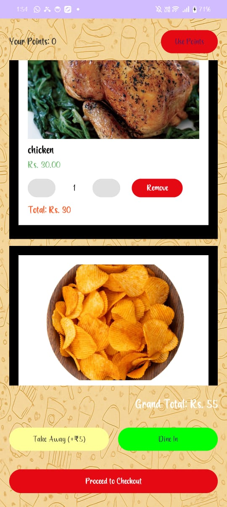
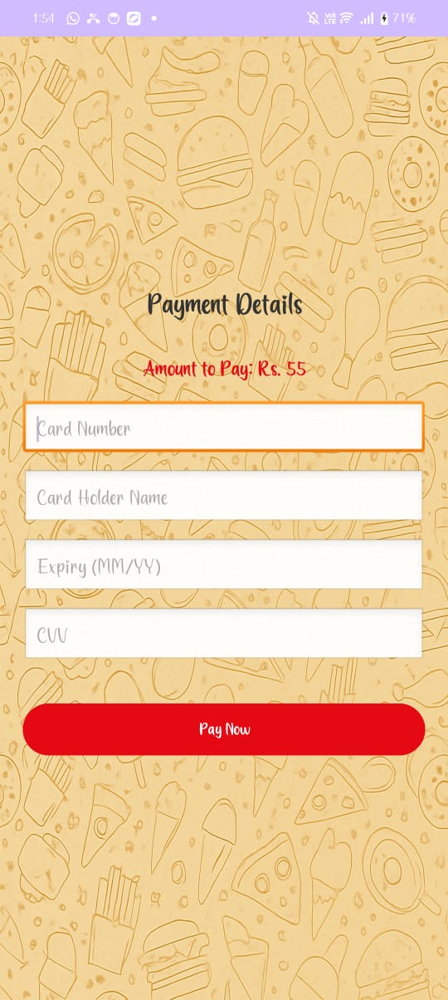
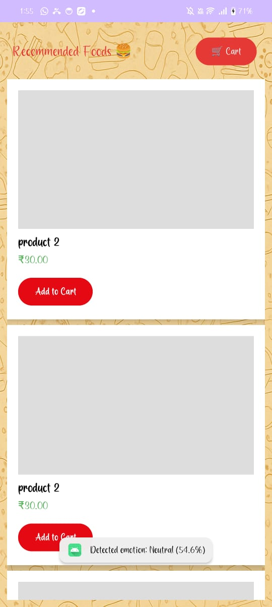
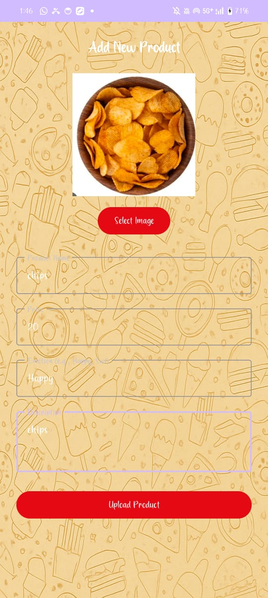
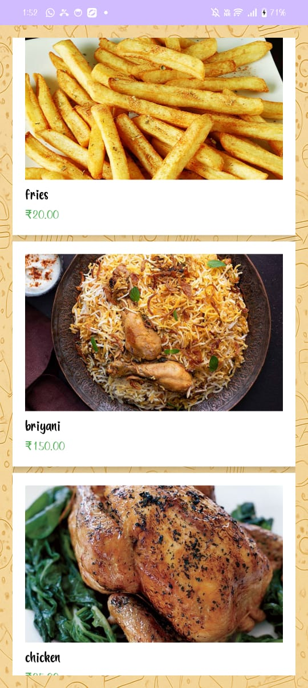

<div align="center">

# 🍽️ DigiDineX

### Mood-Aware AI & Smart Canteen Automation System

An Android canteen app that replaces queues and paper orders with digital ordering, payments, rewards, and **food recommendations based on the user's detected mood**.


</div>

---

## 📌 Overview

Canteens in colleges and workplaces still struggle with long queues, slow order handling, cash-only payments, manual inventory, and one-size-fits-all menus. **DigiDineX** is a two-sided mobile platform (Customer + Admin) that digitizes the whole flow and adds a personalization layer: the app reads the user's facial expression through the camera, detects their mood, and recommends food to match, with Explainable AI (XAI) so users can see *why* an item was suggested.

## 🏆 Publication

This work was **presented at the International Conference on Advanced Technologies and Innovations (ICATI 2026)**, organised under IEEE at NSS College of Engineering, Palakkad, Kerala (8-9 May 2026).

| | |
|---|---|
| **Paper** | *DigiDineX – Mood Aware AI and IoT Enabled Smart Canteen Automation System* |
| **Authors** | Mrs. A. Selvanayagi, Akshita M G, Dhanushree M, Harinipriya B, Kaviya S |
| **Conference** | International Conference on Advanced Technologies and Innovations (ICATI) 2026 |

<details>
<summary>📜 View certificate of presentation</summary>


</details>

## ✨ Features

**Customer**
- Register / log in securely (passwords stored with `password_hash`)
- Browse the live menu with images, prices, and descriptions
- Add items to a cart, choose **Dine In** or **Take Away**, and see the running total
- Pay digitally and receive an order with a unique **QR token** for pickup
- **Emotion detection** via camera (happy / sad / neutral / stressed) with a confidence score
- **Mood-based food recommendations** with Explainable AI
- Post reviews and ratings, and earn **reward points** redeemable on future orders

**Admin**
- Secure admin login
- Add, edit, delete food items; update prices, images, and availability
- Real-time menu updates reflected to all users
- Mark orders as received by scanning/entering the QR token

## 🖼️ Screenshots

| Welcome | Customer Login | Customer Home | Menu |
|:---:|:---:|:---:|:---:|
|  |  |  |  |

| Cart & Checkout | Payment | Mood Recommendations | Feedback |
|:---:|:---:|:---:|:---:|
|  |  |  |  |

| Admin: Add Product | Menu List |
|:---:|:---:|
|  |  |

## 🏗️ Architecture

```
┌──────────────────────┐        HTTP / JSON        ┌────────────────────┐        ┌──────────┐
│  Android App         │ ────────────────────────▶ │  PHP REST API      │ ─────▶ │  MySQL   │
│  (Java + XML)        │ ◀──────────────────────── │  (action-based)    │ ◀───── │  (JDBC / │
│  • Customer module   │                           │  Apache (XAMPP)    │        │   mysqli)│
│  • Admin module      │                           └────────────────────┘        └──────────┘
│  • Camera → Emotion  │
│    detection → Recs  │
└──────────────────────┘
```

**Modules:** Admin Login & Menu Management · User Authentication · Food Menu Display · Booking & Order Management · Online Payment · Review & Rating · Credit Points · Emotion Detection · AI Food Recommendation

## 🛠️ Tech Stack

| Layer | Technology |
|---|---|
| Mobile app | Android (Java, XML layouts, Material UI), Android Studio, Android SDK, Gradle |
| Backend | PHP (REST-style, JSON responses), Apache via XAMPP/WAMP |
| Database | MySQL |
| AI / ML | Facial emotion detection + mood-based recommendation, Explainable AI (XAI) |
| Cloud (planned) | AWS for backend, database, and AI modules |

## 🔌 API Reference

All requests go to a single endpoint with an `action` parameter and return JSON (`{"status": "ok" | "error", ...}`).

| Action | Purpose | Key params |
|---|---|---|
| `register` | Create a user account | `name`, `height`, `email`, `username`, `password` |
| `login` | Authenticate a user | `username`, `password` |
| `get_items` | List menu items (optionally by type) | `type` (optional) |
| `viewbp` | List items filtered by a selected category | `fitness` |
| `place_order` | Create an order and return a QR token | `user_id`, `items` (JSON), `dine_mode`, `total_price` |
| `mark_received` | Mark an order as collected | `qr_token` or `order_id` |
| `feedback` | Save rating/comment and award reward points | `user_id`, `order_id`, `rating`, `comment` |
| `get_rewards` | Fetch a user's reward points | `user_id` |

## 🗄️ Database

Main tables used by the API: `userregister`, `details` (menu items), `orders`, `feedback`.

## 🚀 Getting Started

### Prerequisites
- Android Studio (latest stable) and an Android device or emulator
- XAMPP / WAMP (Apache + MySQL + PHP)

### Backend
1. Copy the PHP API folder into your server's web root (e.g. `htdocs/Android/`).
2. Create a MySQL database and import the schema (tables listed above).
3. Update the config block at the top of the API file:
   ```php
   $db_host = "localhost";
   $db_user = "root";
   $db_pass = "";
   $db_name = "<your_database_name>";
   $base_url = "http://<YOUR_SERVER_IP>/Android/<project_folder>";
   ```
4. Place menu images in the `upload/` folder referenced by `base_url`.

### Android app
1. Clone the repo and open it in Android Studio.
2. Set the API base URL in the app to your server IP (phone and server must be on the same network).
3. Sync Gradle, then run on a device/emulator. Grant **camera permission** for emotion detection.

## 📊 Survey Findings

A survey of students, faculty, canteen staff, and visitors (questionnaires + interviews, online and offline) showed:
- Strong demand for digital ordering and payments
- Preference for mood-based / personalized suggestions
- Staff need better tools for orders and inventory
- Overall positive response to an AI-driven smart canteen

## 🔭 Future Scope

- Cloud deployment on AWS
- Wearable-device integration for mood tracking and nutrition-database lookups
- Data analytics for peak hours, menu planning, and reducing food wastage
- IoT-based crowd monitoring and slot-based food collection

## 👥 Team

| Name | Roll No. |
|---|---|
| Akshita M G | 927622BCS005 |
| Dhanushree M | 927622BCS021 |
| Harinipriya B | 927622BCS033 |
| Kaviya S | 927622BCS045 |


**Institution:** Department of Computer Science and Engineering, M. Kumarasamy College of Engineering (Autonomous), Karur - 639 113


